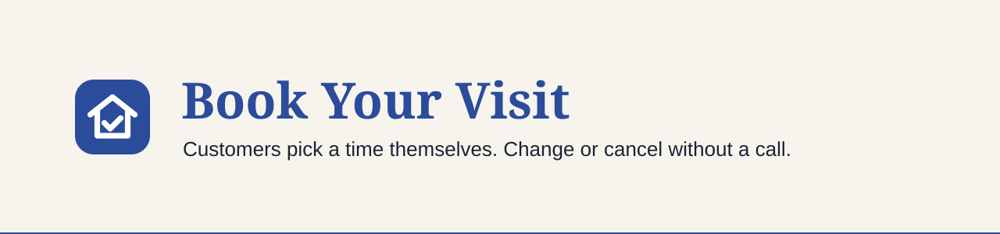

<p align="center"></p>

<p align="center">
  
  
  
  
</p>

**Customers pick their own time: a landing page and a one-click demo of an online booking portal for home-service businesses.**

Not deployed yet. See issue #1 for what is left.

## Status

| Row | |
|---|---|
| Phase | Demo built on `sonnet-build`, waiting for the founder's pick between the two builds |
| Shipped | Landing page and one-click demo, in the branch |
| Next | Pick a build, Vercel deploy, showcase pictures: issue #1 |
| Updated | 2026-11-11 |

## What it does

- A landing page that explains the booking flow and opens the demo with one press.
- The demo plays Coquina Home Cleaning, a made-up cleaning company. The visitor plays a customer.
- The customer picks a service, a day and an open time, enters a name and email, and gets a confirmation.
- From the confirmation the customer can move the visit to another open time, or cancel it.
- A time is open only while one of two crews is free for the whole visit and no one has blocked it.
- The owner's side shows the day's visits by crew, and blocks off a time. A blocked time leaves the booking page at once.
- A visit booked on the customer side shows on the owner's day right away. Cancelling frees the time.

## What it never does

- Sends anything. No email or text leaves the browser; the confirmation is drawn on screen.
- Keeps anything on a server. The demo lives in the page's memory; a reload starts over (ADR 0001).
- Shows a real business, a real person, a price, a statistic or a phone number.
- Lets search engines index the demo. Only the landing page is indexed.

## Stack

Next.js 16 (App Router) and Tailwind 4 on Vercel. No database, no API routes. Vitest for unit tests.

## Run it locally

Needs Node 24 and npm. No env vars.

```bash
npm install
npm run dev
```

## Tests

`npm run test:unit`. Never `npm test` (it fails on purpose). CI runs typecheck, lint, `test:unit` and the build on every PR.

## Docs

- `DESIGN.md`: the look, colors, type and the logo.
- `PRODUCT.md`: who it is for and the voice.
- `docs/adr/0001-browser-only-demo.md`: why there is no backend.

---

<p align="center">Built by <a href="https://tekguyz.com">TEKGUYZ</a></p>
